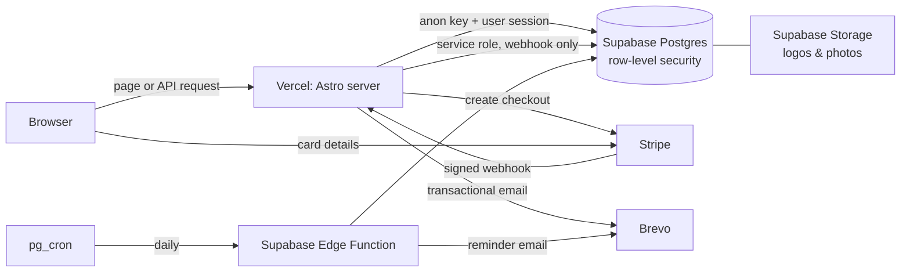
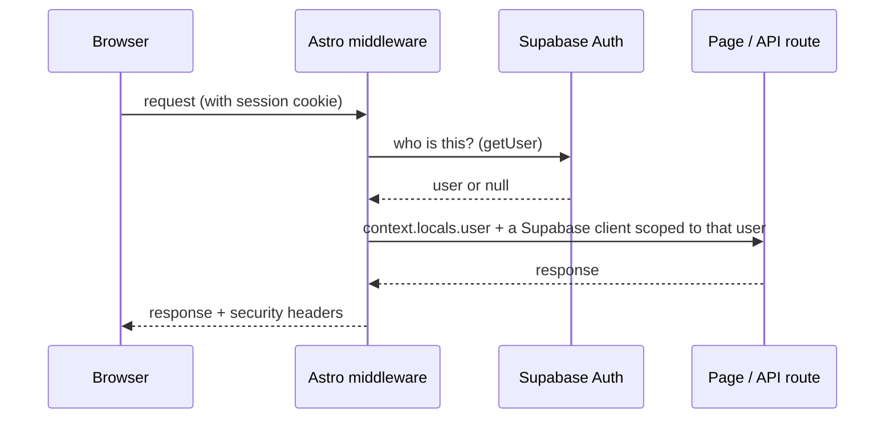
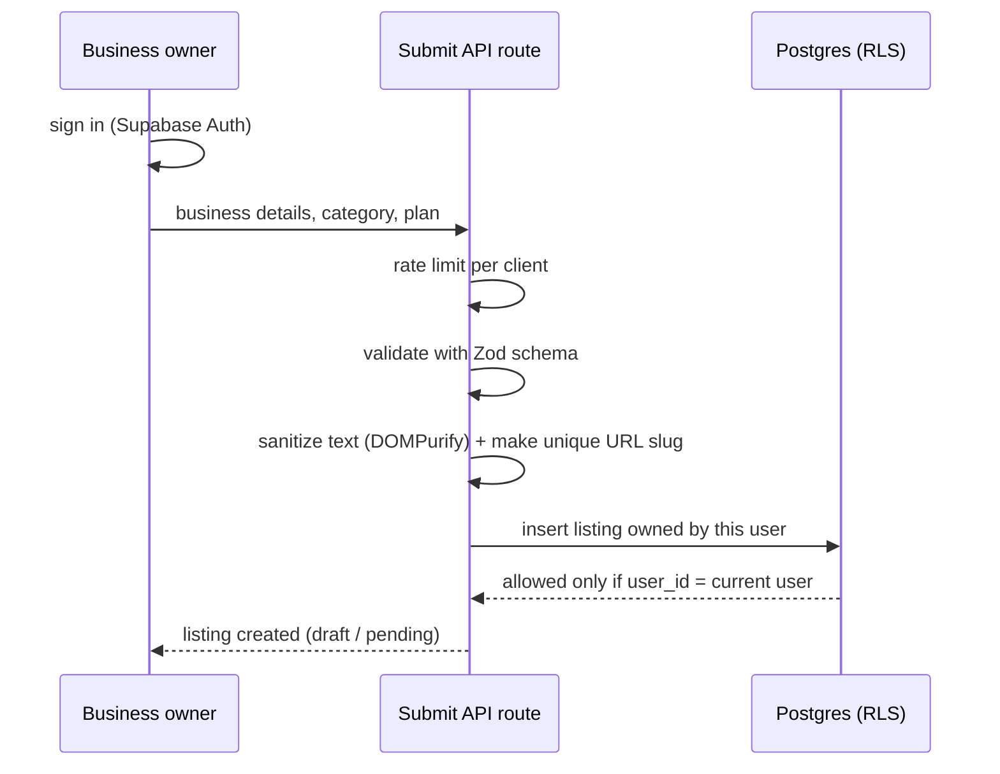
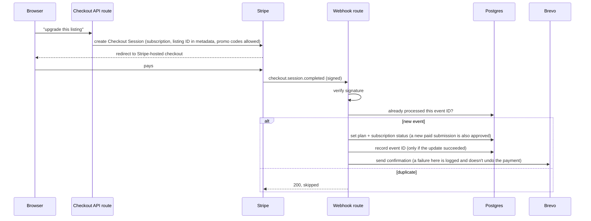
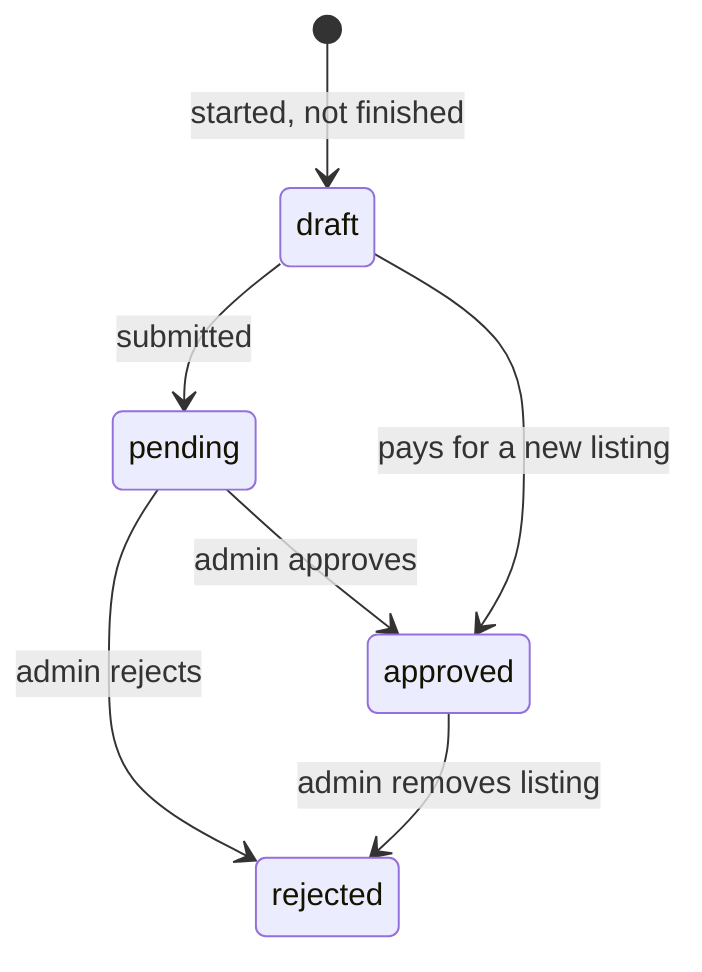

# Data flow

How a request, a listing, and a payment move through the system. The diagrams are [Mermaid](https://mermaid.js.org), which GitHub renders inline.

## The big picture

There are two kinds of database access:

- **As the user** (public anon key plus the visitor's session). This covers almost everything, and row-level security limits what each visitor can see and change.
- **As the server** (service-role key). This is used only where no user is present, such as the Stripe webhook and scheduled jobs.

## 1. Every request

Pages and API routes never parse cookies themselves. They read `locals.user` and use the client the middleware made. Admin pages add one more check: the user's profile must have the admin role.

## 2. Browsing and search

1. The homepage and category pages query listings with the user-scoped client.
2. Row-level security returns **approved** listings to everyone, plus the visitor's own listings in any status.
3. Search filters narrow results as you type. That's a small client-side island; the page itself is server-rendered HTML.

## 3. Submitting a listing

- **Editing** reuses the same form components and validation, so create and edit can't drift apart.
- **Photos and logos** go to Supabase Storage. Anyone can read them, and only the owner can update or delete them.

## 4. Paying for a plan

The same webhook keeps listings in sync for the rest of the subscription's life: renewals (`invoice.payment_succeeded`), failed payments, plan changes (`customer.subscription.updated`), and cancellations (`customer.subscription.deleted`). Owners manage billing through Stripe's hosted customer portal.

## 5. Admin moderation

- Admin API routes check the admin role first, then validate the request with Zod against the single list of allowed statuses.
- **Remove listing** issues the refund in Stripe, cancels the subscription, marks the listing rejected, and records the reason.
- The dashboard shows counts by status and each listing's Stripe status, with bulk actions for clean-up.

## 6. Background jobs

`pg_cron` runs daily inside Postgres and calls a Supabase Edge Function. The function finds unfinished draft listings and sends reminder emails through Brevo. Each run is logged to a table, so failures are visible.

## Where the bugs were

Each of these sat at a boundary in the diagrams above:

| Bug                              | Boundary                                 | Fix                                                                                    |
| -------------------------------- | ---------------------------------------- | -------------------------------------------------------------------------------------- |
| 404s only in production          | Two dynamic routes at the same URL depth | Make routes unambiguous; check route precedence in the production build, not just dev. |
| Stale navigation state           | Server HTML ↔ client island             | Reset client state on navigation instead of assuming a fresh page load.                |
| Payments processed twice         | Stripe → webhook                         | Processed-events table; record an event only after a successful update.                |
| Build failed without credentials | Build time ↔ runtime                    | Create clients lazily on first use (a small Proxy wrapper) instead of at import.       |
